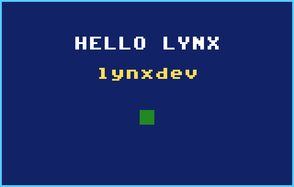

# lynxdev

End-to-end development of Atari Lynx games on macOS, Linux and Windows
(WSL2): C and assembly built with [cc65](https://cc65.github.io/) in Docker,
run in a patched [Handy](https://github.com/libretro/libretro-handy) that
scripts, agents and [Claude Code](https://claude.com/claude-code) can drive
deterministically (MCP server, web DevBench, REST).

No copyrighted ROM is needed: the emulator boots cartridges with a
high-level emulation of the Lynx boot ROM.

In the spirit of the sibling projects for the Amiga, the ZX Spectrum, the
Atari 8-bits and the 3DO.



```sh
./setup.sh                   # toolchain image, emulator, Python env (idempotent)
./lynx new mygame            # a project from sdk/template
./lynx build hello           # -> projects/hello/build/hello.lnx (+ .map, .lbl)
./lynx test hello            # headless, deterministic
./lynx shot hello -o hello.png --scale 3
./lynx run hello             # in a window
./lynx devbench              # web UI + REST + MCP over HTTP on :3690
```

## Setup

Needs git, make, a C/C++ compiler, Docker (any engine: Docker Desktop,
OrbStack, Rancher, colima, docker-ce), Python 3.10+ (or uv), and SDL2 for
the emulator window (headless works without it).

| | |
|---|---|
| macOS | `xcode-select --install`; `brew install sdl2` (optional, for the window); Docker Desktop or OrbStack |
| Debian/Ubuntu | `sudo apt install git build-essential zlib1g-dev libsdl2-dev python3-venv` + docker-ce |
| Windows | WSL2 (`wsl --install -d Ubuntu`), then the Ubuntu line inside it, Docker Desktop with WSL integration |

```sh
git clone --recurse-submodules https://github.com/geekychris/lynxdev && cd lynxdev
./setup.sh          # games/ submodule, lynx-dev-toolchain:1, the emulator and .venv, then ./lynx selftest
./lynx doctor       # if anything is wrong: what, and the command that fixes it
```

`LYNX_NATIVE=1` builds with a cc65 already on PATH instead of Docker.

## Games

The games live in their own repo, [geekychris/lynx_games](https://github.com/geekychris/lynx_games),
checked out here as the `games/` submodule (`setup.sh` fetches it; or
`git submodule update --init`). Ports of the Amiga originals
([amiga_games](https://github.com/geekychris/amiga_games)), redone for 160x102 with
Suzy sprites. Each has a README (controls, what's kept), a headless
play-through test and screenshots in its `images/`. Every `./lynx` command
finds a game by name (`./lynx run rock_blaster`); `./lynx selftest` tests
them when the submodule is there.

| | Game | What it is |
|---|---|---|
|  | [Rock Blaster](https://github.com/geekychris/lynx_games/tree/main/rock_blaster) | vector rock shooter: the original's ship, rocks and rules; Suzy sprites (pre-rotated + flipped ship, scaled title logo), the original's tune on Mikey, 50 fps |
|  | [Frank the Frog](https://github.com/geekychris/lynx_games/tree/main/frank_the_frog) | hop Frank over five lanes of traffic and a river of logs and lily pads into the four ponds; Suzy-scaled title, Mikey sound, 50 fps; a bot test fills all four ponds |

New games: `./lynx new --game <name>` (in `games/`, i.e. the lynx_games repo);
see "Porting into lynx_games" in CLAUDE.md.

## Projects

The platform's own programs, in `projects/`:

| Project | What |
|---|---|
| [hello](projects/hello) | text, a box moved with the pad, log lines, `lynx_done()` |
| [sdktest](projects/sdktest) | every SDK module: sprites (scaled, flipped, recoloured, chained), palette, text, sound, input; its test checks pixels |

## Playing in the window

`./lynx run <project>` opens the emulator in a window:

| Key | Lynx |
|---|---|
| arrow keys | d-pad (they turn with the display when it is rotated) |
| Z or Left Alt | A (outer button) |
| X, Left Ctrl or Cmd | B (inner button) |
| 1 / 2 | OPTION 1 / OPTION 2 |
| P or Return | PAUSE |
| Esc | quit |

Claude and `./lynx ctl` can attach to that window session and drive it while
you watch (`emu_attach()`).

## How it fits together

```
 Claude Code ──stdio──> lynxdev-mcp ─┐
 browser ──────HTTP───> devbench ────┼─JSON lines─> session process ──lynxh protocol──> patched Handy
 ./lynx ctl, test.py ────────────────┘              (lynxdev serve)                     (headless / SDL)
```

| Part | Where |
|---|---|
| `./lynx` | the one entry point (build, test, run, shot, video, record/replay, ctl, devbench, selftest) |
| toolchain | `docker/Dockerfile` (cc65), `bin/lynx-make`, pins in `scripts/lib.sh` |
| SDK | `sdk/` (headers in `sdk/include`, `project.mk`, `cfg/lynx.cfg`, `template/`): [docs/sdk.md](docs/sdk.md) |
| emulator | `emulator/` (Handy patches, harness, headless and SDL frontends): [emulator/README.md](emulator/README.md) |
| harness | `tools/lynxdev` (Python: Emulator API, sessions, CLI, MCP server, DevBench): [docs/emulator-harness.md](docs/emulator-harness.md), [docs/mcp.md](docs/mcp.md) |

More: [docs/getting-started.md](docs/getting-started.md),
[docs/lynx-gotchas.md](docs/lynx-gotchas.md), [CLAUDE.md](CLAUDE.md).

## Licences

Our code: MIT ([LICENSE](LICENSE)). Handy: zlib licence (fetched at a pinned
commit by `scripts/build-emulator.sh`, patched, not vendored). cc65: zlib
licence (built in the Docker image).
