# lynxdev: a modern dev kit for the Atari Lynx, with a scriptable, debuggable emulator

Write games for the **Atari Lynx** (1989) on a Mac or Linux machine (Windows
via WSL2). One command installs a cc65 toolchain (in Docker), builds a
patched Handy emulator with a control socket, a debugger and a log channel,
and runs the tests. The result is a fast **edit → build → run → observe →
test → debug** loop that people, scripts and AI agents (Claude Code via MCP)
can all drive. No copyrighted boot ROM is needed: the emulator boots
cartridges with a high-level emulation of it.

<p>
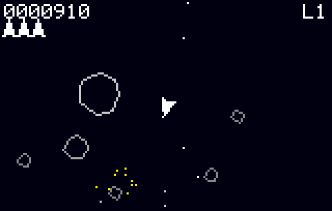
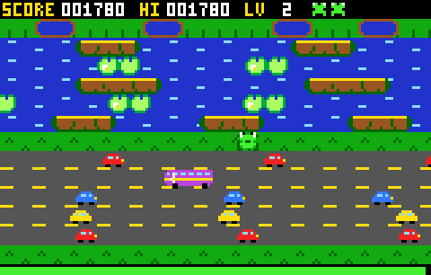
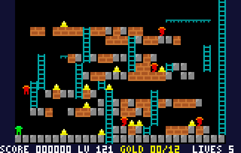
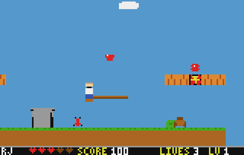
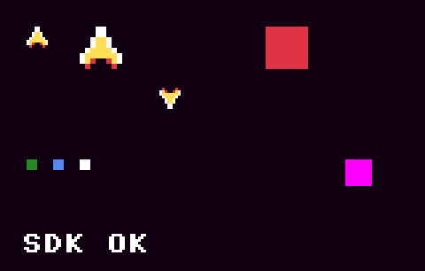
</p>

> Rock Blaster and Frank the Frog, ports of the Amiga originals, and the
> SDK's test screen. Each was written, built, tested and debugged with this
> toolchain; their tests play them headless.

---

## Contents

- [One-line install](#one-line-install)
- [Manual install](#manual-install)
- [First steps](#first-steps)
- [The games and the arcade](#the-games-and-the-arcade)
- [How it works](#how-it-works)
- [Everyday commands](#everyday-commands)
- [Remote control and debugging](#remote-control-and-debugging)
- [DevBench: web UI, REST API, Suzy/Mikey inspection](#devbench-web-ui-rest-api-suzymikey-inspection)
- [Working with Claude Code](#working-with-claude-code)
- [Writing Lynx programs](#writing-lynx-programs)
- [Repository layout](#repository-layout)
- [Documentation index](#documentation-index)
- [Troubleshooting](#troubleshooting)
- [Licensing and credits](#licensing-and-credits)

---

## One-line install

The repos are private for now, so the installer is fetched with the GitHub
CLI (logged in with `gh auth login`, with access to geekychris/lynxdev and
geekychris/lynx_games):

```sh
gh api -H "Accept: application/vnd.github.raw" repos/geekychris/lynxdev/contents/scripts/install.sh | bash
```

or

```sh
curl -fsSL -H "Authorization: token $(gh auth token)" \
  https://raw.githubusercontent.com/geekychris/lynxdev/main/scripts/install.sh | bash
```

Once the repos are public: `curl -fsSL https://raw.githubusercontent.com/geekychris/lynxdev/main/scripts/install.sh | bash`.

It checks prerequisites, clones lynxdev with its games to `~/lynxdev`,
runs `./setup.sh` (toolchain image, emulator, Python env, selftest: 3-10
minutes) and opens the games menu. Re-run it any time to update. Add
`LYNX_DEV_AUTO_INSTALL=1` before `bash` to install missing prerequisites
too (brew / apt / dnf / pacman). Knobs: `LYNX_DEV_SRC`, `LYNX_DEV_REF`,
`LYNX_DEV_REPO` (SSH), `LYNX_DEV_QUICK=1`, `LYNX_DEV_START=0`; see
[docs/install.md](docs/install.md) and the header of
[scripts/install.sh](scripts/install.sh).

## Manual install

| | macOS | Debian / Ubuntu |
|---|---|---|
| git, make, C/C++ compiler | `xcode-select --install` | `sudo apt install git build-essential zlib1g-dev` |
| Docker (any engine) | Docker Desktop, OrbStack, Rancher Desktop or colima | `sudo apt install docker.io` + the `docker` group |
| Python ≥ 3.10 (or [uv](https://docs.astral.sh/uv/)) | `brew install python@3.12` or `brew install uv` | `sudo apt install python3 python3-venv` |
| SDL2 (the window) | `brew install sdl2` | `sudo apt install libsdl2-dev` |
| ffmpeg (optional, `.mp4`) | `brew install ffmpeg` | `sudo apt install ffmpeg` |

```sh
git clone --recurse-submodules https://github.com/geekychris/lynxdev.git && cd lynxdev
./setup.sh        # games submodule, toolchain image, emulator, .venv, selftest (--quick skips it)
./lynx doctor     # checks every piece and says how to fix what's broken
./lynx arcade     # the games menu
```

Fedora, Arch, Windows (WSL2), private-repo cloning and troubleshooting:
[docs/install.md](docs/install.md).

## First steps

```sh
./lynx arcade                  # pick a game, play it in a window (Esc returns to the menu)
./lynx new --game mygame       # your own game, from the template, in games/mygame
$EDITOR games/mygame/src/main.c
./lynx run mygame              # builds, opens a window
./lynx test mygame             # headless test (games/mygame/test.py)
./lynx devbench --open         # look inside: screen, registers, memory, Suzy/Mikey, sprites
                               # (and http://127.0.0.1:3690/arcade: every game, Play in the page)
```

Then follow [docs/getting-started.md](docs/getting-started.md), a tutorial
from install to your own game with sprites, sound, tests and debugging,
and [docs/game-dev.md](docs/game-dev.md).

## The games and the arcade

The games live in their own repo, [geekychris/lynx_games](https://github.com/geekychris/lynx_games),
checked out here as the `games/` submodule (`setup.sh` fetches it; by hand:
`git submodule update --init`). Mostly ports of the Amiga originals
([amiga_games](https://github.com/geekychris/amiga_games)), redone for the
Lynx's 160x102 screen with Suzy sprites and Mikey sound. Each has a README
(controls, what was kept), a headless play-through test and screenshots.

| | Game | What it is |
|---|---|---|
|  | [Rock Blaster](https://github.com/geekychris/lynx_games/tree/main/rock_blaster) | vector rock shooter: the original's ship, rocks and rules; Suzy sprites (pre-rotated + flipped ship, scaled title logo), the original's tune on Mikey, 50 fps |
|  | [Frank the Frog](https://github.com/geekychris/lynx_games/tree/main/frank_the_frog) | hop Frank over five lanes of traffic and a river of logs and lily pads into the four ponds; Suzy-scaled title, Mikey sound, 50 fps; a bot test fills all four ponds |
| 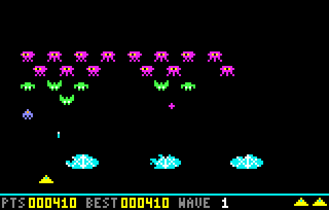 | [Nova Defense](https://github.com/geekychris/lynx_games/tree/main/nova_defense) | defend the base against a marching swarm of 48 aliens, a comet and wearing shields; the original's art at half size, its march and tune on Mikey, 50 fps; a bot test clears two waves and shoots a comet |
|  | [Bullion Dash](https://github.com/geekychris/lynx_games/tree/main/bullion_dash) | dig traps, take the gold, climb out: all 150 repaired levels on one 160x102 screen, the original's guards and path search, its four-channel tune on Mikey; bot tests win levels by route search |
|  | [Jump Quest](https://github.com/geekychris/lynx_games/tree/main/jump_quest) | RJ and Dale's side-scrolling platformer: three levels, four enemy types, one or two players; pixel-smooth scrolling with Suzy, 46-50 fps; an autoplay test clears all three levels |
| 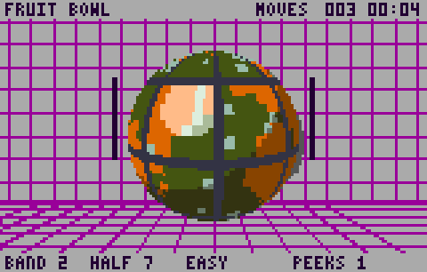 | [Boing Twist](https://github.com/geekychris/lynx_games/tree/main/boing_twist) | twist the bands of a Boing ball until the picture is whole again; best moves and time per picture as in the original, colour-cycled title ball |
| 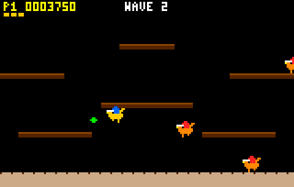 | [Sky Knights](https://github.com/geekychris/lynx_games/tree/main/sky_knights) | joust flying knights on ledges: flap, land on top, collect the pods before they hatch; the original's rules and waves, Suzy-mirrored knights, its tune on Mikey, 50 fps |
| 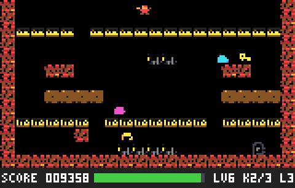 | [Miner Meteor](https://github.com/geekychris/lynx_games/tree/main/miner_meteor) | collect the keys in six caverns before the air runs out, past spikes and guardians; solver tests clear all six caverns with the original's scores, 50 fps |
| 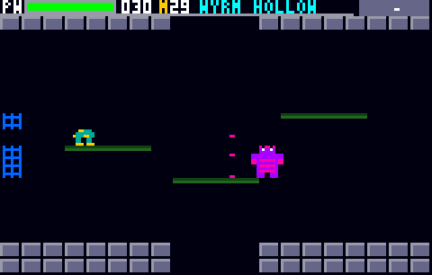 | [Orb Hunter](https://github.com/geekychris/lynx_games/tree/main/orb_hunter) | explore a world of rooms with roll form, bombs and rockets, nine power-ups and two bosses; the original's world byte for byte, its tune on Mikey, 50 fps in play |
| 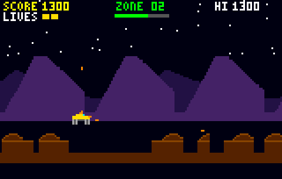 | [Lunar Rider](https://github.com/geekychris/lynx_games/tree/main/lunar_rider) | drive a moon buggy over craters, rocks and mines while shooting UFOs and meteors; two parallax mountain ranges scrolled by Suzy, 50 fps |

**The arcade** (`./lynx arcade`, or `scripts/arcade.sh`) lists every game it
finds in `games/` with a one-line description, builds the one you pick and
opens it in a window; when you close the window you're back in the menu.

```
Lynx arcade  (10 games)
  1  Boing Twist     A twisty puzzle on the Boing ball.
  2  Bullion Dash    Collect all the gold on the screen, dig holes in the brick floors, keep away …
  3  Frank the Frog  Hop Frank across five lanes of traffic and a river of logs and lily-pad rafts…
  4  Jump Quest      RJ and Dale's side-scrolling platformer.
  5  Lunar Rider     Drive a moon buggy along a scrolling lunar surface with parallax mountains.
  6  Miner Meteor    In each of six caverns collect every key to unlock the exit, then reach it be…
  7  Nova Defense    Defend the base against a staggered swarm of 48 aliens in three kinds (eye po…
  8  Orb Hunter      Explore the lost caverns.
  9  Rock Blaster    A vector rock shooter.
 10  Sky Knights     Joust on flying mounts.

number = play, i<number> = info/controls, r = rescan, q = quit >
```

| | |
|---|---|
| `./lynx arcade --list` | the list, no menu (`--json` for scripts) |
| `./lynx arcade --all` | also the platform's projects (hello, sdktest) |
| `./lynx arcade --play rock_blaster` | straight into one game |
| `./lynx arcade --devbench` | also run DevBench: the game's session shows in the web UI |

**Window keys:** arrows = d-pad, Z or Left Alt = A (outer button), X /
Left Ctrl / Cmd = B (inner), 1 / 2 = OPTION 1 / 2, P or Return = PAUSE, Esc
closes the window. A game can describe itself in `game.json`
(`{"title", "description", "controls"}`); otherwise the arcade reads its
README.

### Every way to run a game

A game is named by its directory (`miner_meteor`); `projects/` names
(`hello`, `sdktest`) work the same, and `run`/`serve` also take a `.lnx`
file. Each command builds first if needed.

| To... | Run | What you get |
|---|---|---|
| pick from a menu | `./lynx arcade` | the menu above; a window per game, back to the menu on Esc |
| play one game | `./lynx arcade --play miner_meteor` (name or menu number) | straight into its window |
| play and look inside | `./lynx arcade --devbench`, or `./lynx run <game>` with `./lynx devbench --open` | the window, plus the live screen, registers, memory, Suzy/Mikey and log at http://localhost:3690 |
| play in the browser | `./lynx devbench`, then http://127.0.0.1:3690/arcade: **Play in page** | the game live in the DevBench screen, played with the keyboard (arrows, Z = A, X = B, 1/2, P), with the log, registers, memory and Suzy/Mikey beside it |
| pick from a page of pictures | http://127.0.0.1:3690/arcade (`./lynx devbench`) | every game with its picture, description and controls; **Build**, **Play in page**, **Play in window** |
| boot any project in the browser | `./lynx devbench --open`, pick it in the project list, **Build**, then **Boot headless** (or **Boot in window**) | a paused session in the web UI; the d-pad buttons, **Press** (`UP+A`), or tick **keyboard** and **live** |
| drive it from a script | `./lynx serve <game> [--window]`, then `./lynx ctl <cmd>` | a paused session that runs frames on command (`./lynx ctl help`) |
| run it with no window | `./lynx arcade --play <game> --headless --frames 300 -o shot.png` | a screenshot after N frames |
| test it | `./lynx test <game>` | its play-through bot (`test.py`) |
| capture it | `./lynx shot`, `./lynx video`, `./lynx record` / `./lynx replay` | PNG, GIF/MP4, input recorded and replayed frame for frame |
| let Claude play or debug it | Claude Code in this directory (`.mcp.json` server `lynx`) | the same controls as MCP tools (`emu_boot`, `emu_press`, `emu_look`, ...) |

`./lynx sessions` lists running sessions; [docs/debugging.md](docs/debugging.md)
covers breakpoints, stepping and memory, [docs/mcp.md](docs/mcp.md) the MCP
tools and REST API.

New games: `./lynx new --game <name>`, then "Porting into lynx_games" in
[CLAUDE.md](CLAUDE.md).

## How it works

```
 Claude Code ──stdio──> lynxdev-mcp ─┐
 browser ──────HTTP───> devbench ────┼─JSON lines─> session process ──lynxh protocol──> patched Handy
 ./lynx ctl, test.py ────────────────┘              (lynxdev serve)                     (headless / SDL)
```

- **Toolchain:** cc65 (C compiler, ca65 assembler, ld65 linker) at a pinned
  commit, in a Docker image built for your machine. A project is a Makefile
  that includes `sdk/project.mk`; the output is a `.lnx` cartridge image
  plus the map and symbol files the debugger uses.
- **SDK** (`sdk/`): the log channel, screen and frame clock (on cc65's TGI
  driver), Suzy sprites, a small font, Mikey sound, input, Suzy maths.
- **Emulator** (`emulator/`): libretro-handy at a pinned commit plus a
  harness: a control socket, deterministic paused sessions, the guest log
  channel (`$FCF0`), breakpoints and watchpoints, Suzy/Mikey views,
  screenshots, input recording and replay, states. A headless binary for
  tests and tools, an SDL window for people.
- **Harness** (`tools/lynxdev`, Python): the Emulator API tests use,
  sessions that several clients share, the `./lynx` CLI, the MCP server and
  DevBench.

## Everyday commands

```sh
./lynx build <p>             # -> <dir>/build/<p>.lnx (+ .map .lbl .dbg); <dir> = projects/<p> or games/<p>
./lynx build <p> RELEASE=1   # no harness log
./lynx run <p>               # window (free-running; Claude and ./lynx ctl can attach)
./lynx test <p>              # <dir>/test.py, else wait for LYNX:DONE / LYNX:FAIL
./lynx log <p> --frames 600 --press A@100
./lynx shot <p> -o shot.png --until "ready" --press PAUSE@100 --scale 3
./lynx video <p> -o clip.gif --until "ready" --frames 150 --hold LEFT@20 --release ALL@80
./lynx record <p> -o r.json --press A@200 ; ./lynx replay r.json --runs 2
./lynx sprite art/ship.txt -o <dir>/src/ship.c   # text art or PNG -> Suzy sprite data
./lynx new [--game] <name>   # from the template
./lynx arcade                # the games menu
./lynx selftest              # build + test everything (before you say "done")
./lynx doctor                # environment problems
```

`./lynx help` lists them all. Frames are display refreshes (60 Hz by
default, 50 or 75 with `gfx_set_rate`).

## Remote control and debugging

Every session (a window from `./lynx run` or the arcade, a headless
`./lynx serve`, DevBench's Boot, MCP `emu_boot`) takes commands:

```sh
./lynx serve rock_blaster &              # headless and paused: nothing runs until you say so
./lynx ctl run_until text="rb: title"
./lynx ctl press keys=A
./lynx ctl break addr=hit_scan           # C or asm symbols from the .lbl
./lynx ctl continue
./lynx ctl disasm addr=pc count=6        # 65SC02, with symbols
./lynx ctl watch addr=gs_lives kind=w    # who writes it?
./lynx ctl read_mem addr=ship_px length=4
./lynx ctl hw                            # Suzy and Mikey registers
./lynx ctl scb_chain                     # the sprites Suzy drew, decoded
./lynx ctl save_state path=boss
./lynx ctl help                          # everything
```

Breakpoints (conditional too), watchpoints, stepping, backtraces, memory
search, the log channel, record/replay and save states:
[docs/debugging.md](docs/debugging.md).

## DevBench: web UI, REST API, Suzy/Mikey inspection

```sh
./lynx devbench --open        # http://127.0.0.1:3690/
```

The live screen, run/step controls, a d-pad, the guest log, registers and
disassembly, breakpoints, a memory viewer, Suzy and Mikey registers, the
palette, the sprite chain inspector and a command console. Tick **live**
for a ~20 fps screen and **keyboard** to play with the keys (arrows = d-pad,
Z = A, X = B, 1 / 2 = Option 1 / 2, P or Return = Pause). Everything is
also REST (`curl localhost:3690/api/cmd/regs`) and MCP over HTTP at
`/mcp`. [docs/mcp.md](docs/mcp.md).

**The arcade page**, http://127.0.0.1:3690/arcade (the **Arcade** link in
the DevBench header), shows every game in games/ with its picture,
description and controls (the same discovery as `./lynx arcade`, so a game
pulled into games/ appears on the next page load; **projects/ too** adds
hello and sdktest). Each game has:

- **Build**: builds it (a failed build's reason stays on the card);
- **Play in page**: builds it if needed, starts it running in a headless
  session and opens the DevBench page on it, live, with the keyboard on
  (playing another game in the page stops the previous one);
- **Play in window**: the same in an emulator window (Esc closes it).

The picture is `games/<g>/images/<g>.png` (else `<g>_title.png`, any PNG in
`images/`, or `docs/images/games/<g>.png`).

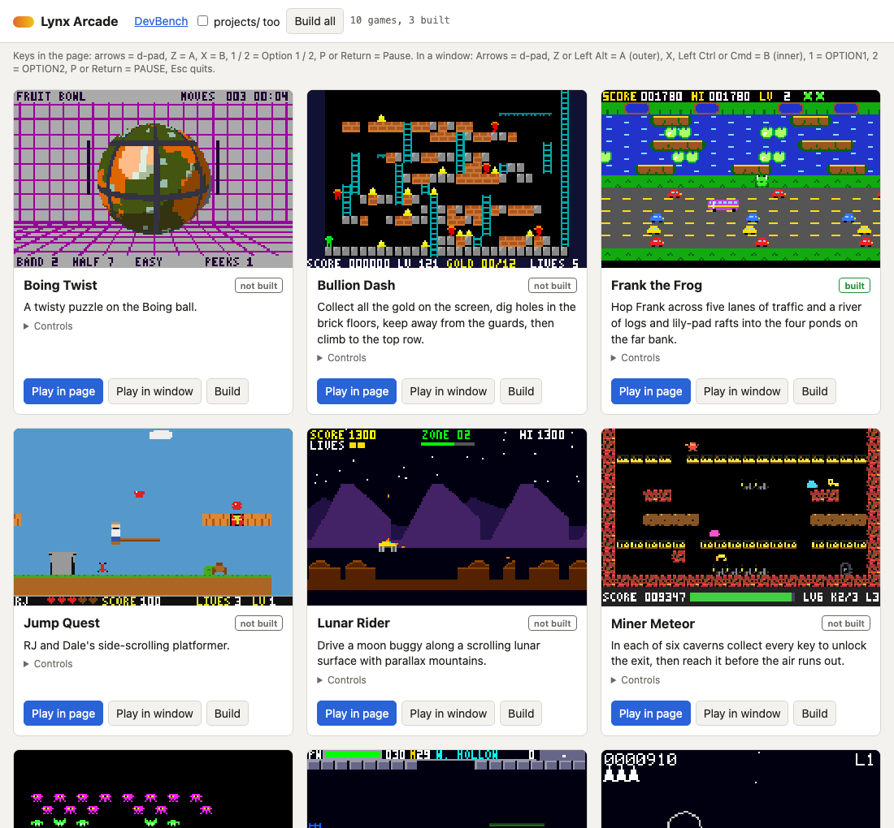

## Working with Claude Code

Open the repo with `claude`. `.mcp.json` registers the MCP server "lynx":
60 tools to build (`build`), boot (`emu_boot`), run (`emu_run_until`), see
(`emu_look`), play (`emu_press`), debug (`emu_break`, `emu_watch`,
`emu_stepi`, `emu_regs`, `emu_disasm`), inspect the hardware (`emu_hw`,
`emu_palette`, `emu_scb_chain`), record and replay. [CLAUDE.md](CLAUDE.md)
holds the rules Claude follows here; [docs/mcp.md](docs/mcp.md) lists the
tools.

## Writing Lynx programs

```c
#include "lynxgame.h"

int main(void)
{
    gfx_init();                               /* 160x102, 60 Hz */
    lynx_log("mygame: ready\n");              /* tests wait for this */
    for (;;) {
        input_update();
        gfx_clear(COLOR_BLACK);
        spr_draw(&ship);                      /* a Suzy sprite (lynxspr.h) */
        text_small(2, 2, COLOR_WHITE, "SCORE");
        gfx_present();                        /* show it at the vertical blank */
        snd_tick();
    }
}
```

- [docs/getting-started.md](docs/getting-started.md): the tutorial.
- [docs/game-dev.md](docs/game-dev.md): frame loop, sprite chains, erasing vs
  clearing, sound, fixed point, asm hot loops, cycle budgets, release builds
  and cartridge size, with Frank the Frog and Rock Blaster as worked examples.
- [docs/sdk.md](docs/sdk.md): every SDK function.
- [docs/lynx-gotchas.md](docs/lynx-gotchas.md): what bites.
- [docs/resources.md](docs/resources.md): the Lynx hardware docs, cc65's
  Lynx target, BLL, emulators, the community.

## Repository layout

```
lynx                    the CLI (./lynx help)
setup.sh                one-shot setup; scripts/install.sh is the curl | bash installer
sdk/                    the SDK: include/, src/, cfg/, project.mk, template/
projects/               the platform's own programs: hello, sdktest
games/                  submodule: geekychris/lynx_games, one directory per game
emulator/               the Handy patches, the lynxh harness, headless + SDL frontends
tools/lynxdev/          Python: Emulator API, sessions, CLI, arcade, MCP server, DevBench; tests/
docker/, bin/lynx-make  the cc65 toolchain image and the build wrapper
scripts/                setup steps, doctor, install.sh, arcade.sh, check_links.py
docs/                   the documentation
third_party/, build/    fetched and generated (git-ignored)
```

## Documentation index

| | |
|---|---|
| [docs/install.md](docs/install.md) | install: one line, manual per OS, doctor, troubleshooting |
| [docs/getting-started.md](docs/getting-started.md) | tutorial: from nothing to your own game |
| [docs/game-dev.md](docs/game-dev.md) | how a Lynx game is built with this SDK |
| [docs/sdk.md](docs/sdk.md) | SDK reference |
| [docs/debugging.md](docs/debugging.md) | debugger, inspection, record/replay, common crashes |
| [docs/lynx-gotchas.md](docs/lynx-gotchas.md) | hardware, cc65 and harness pitfalls |
| [docs/emulator-harness.md](docs/emulator-harness.md) | the Python Emulator API |
| [docs/mcp.md](docs/mcp.md) | sessions, MCP tools, REST |
| [docs/resources.md](docs/resources.md) | external Lynx, cc65 and 65SC02 references |
| [emulator/README.md](emulator/README.md) | the emulator patch and its raw protocol |
| [sdk/README.md](sdk/README.md) | SDK versioning and changelog |
| [CLAUDE.md](CLAUDE.md) | the rules for Claude Code (and a good summary for people) |

## Troubleshooting

| | |
|---|---|
| anything | `./lynx doctor` (each problem with its fix) |
| `git clone` fails / repo not found | the repos are private: `gh auth login`, see [docs/install.md](docs/install.md) |
| `games/ ... isn't checked out` | `git submodule update --init` |
| Docker not running | start Docker Desktop / OrbStack / `colima start`; Linux: `sudo systemctl start docker` |
| no window | install SDL2, then `scripts/build-emulator.sh` |
| a build fails | the error is printed; the log is in `build/` |
| a test fails | it prints the guest log's last lines; `./lynx log <p>` and [docs/debugging.md](docs/debugging.md) |
| more | [docs/install.md](docs/install.md#troubleshooting) |

## Licensing and credits

Our code: MIT ([LICENSE](LICENSE)). The games in lynx_games: MIT.

- [Handy](https://github.com/libretro/libretro-handy) (K. Wilkins, the
  libretro team): zlib licence; fetched at a pinned commit and patched, not
  vendored.
- [cc65](https://cc65.github.io/) (Ullrich von Bassewitz and contributors;
  the Lynx library by Shawn Jefferson, Karri Kaksonen, Bastian Schick and
  others): zlib licence; built inside the Docker image.
- The Lynx documentation the SDK was written from: the Epyx/Atari developer
  docs as hosted by Bastian Schick, and the community's
  [resources](docs/resources.md).
- No Atari or Epyx ROM is included, needed or downloaded.
