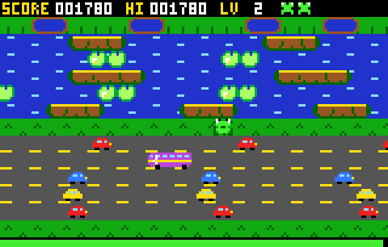
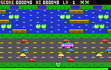

# Frank the Frog (Atari Lynx)

Port of `amiga_mcp/examples/frank_the_frog`: hop Frank across five lanes of
traffic and a river of logs and lily-pad rafts into the four ponds on the
far bank. 10 points for each new row, 50 for a pond, 1000 for each level
(all four ponds); every level the traffic and the river speed up (up to
level 6). Three lives, a timer per frog.





```sh
./lynx run frank_the_frog            # in a window
./lynx test frank_the_frog           # a bot plays it headless (test.py)
./lynx build frank_the_frog RELEASE=1   # no harness log
```

## Controls

| Lynx | Window key | |
|---|---|---|
| d-pad | arrow keys | hop (one hop a press) |
| A or B | Z / X | start (title), back to the title (game over) |
| PAUSE | P or Return | pause / resume |
| OPTION 2 (title) | 2 | starting level 1-4 |
| OPTION 1 (title) | 1 | music on / off |

## The Lynx version

- **One chain of Suzy sprites a frame** (`src/render.c`): the HUD strip, the
  13 rows, the 30 lane objects, the frogs in the ponds, Frank, the HUD
  glyphs, lives and the timer bar; the overlays (title, level complete,
  game over, paused) are glyphs added to the end of the same chain. The
  rows are background-type sprites (the far bank with its ponds in 4 bpp;
  river, grass and road rows in 1 bpp, two pens each), so nothing is ever
  cleared.
- **Suzy does the work the original did with RectFill and Blitter bobs**:
  one car picture recoloured per lane through its pen palette (red, yellow,
  blue) and mirrored (HFLIP) for the lanes that go left, the bus likewise;
  Frank mirrored and flipped to face the way he hops; his splat drawn scaled
  and shrinking (the original's red X closing in); the title's Frank and
  the big lettering scaled 2x/3x from small pictures; the timer bar and the
  boxes are one pixel scaled to size. Objects running off the screen edges
  are clipped by Suzy.
- **Art** is text files in `art/` turned into sprite data by `./lynx sprite`
  (`tools/mkart.py` generates the logs and the rows, then converts it all).
  A 3x5 font (`art/font.txt`) for the HUD and the overlays.
- **Mikey sound** (`src/sound.c`): hop blip (rising), splat (low noise),
  splash (hiss), pond and level jingles, the game-over fall and the
  original's E-F chromatic riff as a bass line during play.
- **50 Hz**, the speed the Amiga original was tuned for (PAL): lanes move the
  original's pixels a frame.

## What was kept, what changed

`src/lanes.c`, `src/frank.c` and `src/score.c` are the original's rules in
the original's 320-pixel coordinates (shown at half width: 20 columns of 8
pixels, rows of 7 lines), and `game_tick()` in `src/main.c` is the
original's state machine: lane layout and speeds per level, the forgiving
collision insets, riding logs, being carried off the screen, the pond
landing zones, scoring, lives, levels. They come by way of the a8dev port.
Port changes are marked `port:` in the source:

- a lane is a circular track: an object leaving one side comes back exactly
  a lane-length later (the original reset it to minus its width, dropping 0
  to speed-1 pixels of overshoot).
- what you see holds you: the original didn't let Frank stand on a log that
  was partly off the screen (it didn't draw those); Suzy draws them clipped.
- added: a 60-second timer per frog (a bar at the bottom: green, yellow,
  red); time out costs a life. The original had no time limit; it is long
  enough not to change how the game plays.
- added: pause, a starting level and music on/off on the title, the lanes
  moving behind the title. The high score lasts until power-off (no
  EEPROM).
- the MOD music is a one-channel riff; the sampled effects are Mikey tones
  and noise.
- speed: lanes and object positions are struct-of-arrays, the per-frame lane
  work is in 6502 assembly (`src/lanes_asm.s`, the C beside it under
  `#if 0`), the score is kept as decimal digits too (no 32-bit division for
  the HUD), the sound periods are compile-time constants.

## Frame rate

50 frames a second while playing (measured by the test: the game counts its
loops and the vertical blanks it missed, `loop_count` / `late_frames`):
49.5 fps over a whole game in the harness build, the 12 late frames all at
state changes (dying, level complete, game over) where log lines are
written, which cost the harness build ~300 cycles a character. A frame
while playing takes about 50,000 of the 80,000 cycles (4 MHz / 50), a hop
frame about 68,000; Suzy's drawing is ~35,000 of that.

## Test

`./lynx test frank_the_frog` (test.py): boots to the title, A starts a game,
hops straight up into the traffic until a car gets Frank (a life lost),
then a bot plays: it stops at the start of every game loop
(`input_update`), reads the lanes (`obj_x`, `lane_*`, `frank_probe`,
`home_filled`) and searches ahead through the game's own rules for the hops
that keep Frank alive and take him up, into the free ponds: all four, so
level 2 (score past 1000). Then PAUSE (nothing moves), the timer (set to 2
frames: a life lost to time), careless hops to game over, A back to the
title with the high score kept, and the frame rate. `--shots` rewrites
`docs/images/frank_the_frog.png` and `.gif` (repo root); `--debug` prints the bot's last
moves before each death and every late frame.
