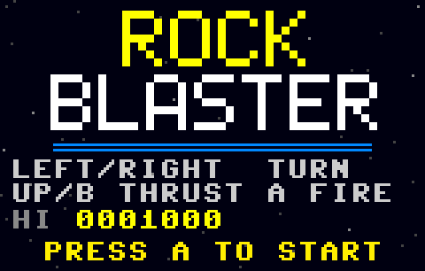
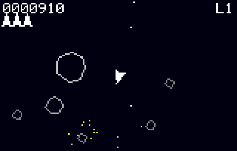
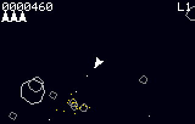

# Rock Blaster (Atari Lynx)

Port of `amiga_mcp/examples/rock_blaster`: a vector rock shooter. Turn,
thrust and fire; large rocks split into two medium ones, medium into two
small (20 / 50 / 100 points); clear the screen and the next wave brings two
more large rocks. Three lives, 100 frames of safety after each respawn
(the ship blinks), everything wraps around the screen. The original's tune
plays on two Mikey channels.

 



```sh
./lynx build rock_blaster            # RELEASE=1: no harness log
./lynx run rock_blaster              # in a window
./lynx test rock_blaster             # a bot plays a game (test.py)
```

## Controls

| Lynx | | window keys |
|---|---|---|
| d-pad LEFT / RIGHT | turn | arrow keys |
| d-pad UP or B | thrust | up arrow, X |
| A | fire: one shot every 8 frames while held, as the original | Z |
| A (title) | start | Z |
| OPTION 1 (title) | music on / off | 1 |
| PAUSE | pause / go on | P or Return |
| PAUSE, then OPTION 1 | back to the title (the Lynx's usual restart) | P, 1 |
| A (game over) | back to the title (or wait 3 s) | Z |

## What was kept

`src/game.c` is the original's logic (by way of the Atari 8-bit port's
16-bit sums): the ship's thrust (0.20 px), drag (253/256 a frame), speed
limit and 16.16 position; turning 3/256 of a circle a frame; bullets at
4 px a frame for 40 frames; rock speeds 0.4-0.8 px a frame (x1.5 medium, x2
small); circle collisions with the original's radii (rocks 20/12/6, ship 8,
bullet 2); the scoring, the waves (4 large rocks + 2 a wave, at most 24
rocks), three lives, the respawn (100 frames) and game-over (150 frames)
timers, and the order of the update. It runs at the original's 50 Hz
(`gfx_set_rate(50)`), one update a frame. Changes are marked `port:` in
the source.

## The Lynx version

- **The world** is the original's 320 pixels across and 204 high (port:
  was 256), shown at half size on the 160 x 102 LCD, so every speed, radius
  and timer is the original's and a screen pixel is two world pixels.
  Positions are 1/128 world pixel: the high byte is the screen pixel.
- **Everything that moves is a Suzy sprite**, one chain of 113 SCBs drawn
  in one go: 24 rocks, 8 bullets, 64 explosion particles, the ship and its
  flame, the HUD's lives and digits. Art is 1 bit per pixel, coloured by
  each SCB's pen palette (rocks light / medium / dim grey by size, as the
  original).
- **Rocks** are the original's 4 polygon outlines per size, halved
  (`tools/mkart.py` draws them). The original never rotated its rocks
  (it stored an angle and spin it didn't use), so neither does this.
- **The ship** is the original's 5-corner outline, filled (at half size the
  outline was a smudge) and drawn a little over half size (0.6) so its
  notch shows. 17 pre-rotated frames cover 0-90 degrees; Suzy's horizontal
  and vertical flips make the other three quarters (64 directions).
- **The title** logo is the original's 5x7 title font, zoomed in from
  nothing to 3x by Suzy's scaler; the stars are the original's (its random
  sequence and seed), halved.
- **The HUD** (score, lives, wave) is sprites too, digits in the same 5x7
  style.
- **Sound**: the original's sampled effects become Mikey sounds of the same
  shape on channels 0 and 1: a falling square-wave blip for a shot, long
  and short noise bursts for large and small rocks, falling tone + rumble
  for the ship. The original's MOD ("rock storm") lead and bass play on
  channels 2 and 3 (`tools/mkmusic.py` turns `tools/rock_blaster.mod` into
  note lists and Mikey timer values; drums and counter-melody are dropped).
- **High score**: kept while the Lynx is on (no EEPROM save); the title
  shows it, game over says NEW HIGH SCORE.

Other `port:` changes: rocks spawn at 8-bit random edge positions (a step
under 1.3 world pixels); explosion particles take one of 64 velocities
made at start-up the original's way (random direction, random speed 0-3
px) and their slowed-down paths are precomputed; a particle that leaves the
screen is gone (the original kept moving it, invisible); the original
restarted a game at once after game over, this one goes back to the title.

## Speed

The game holds **50 fps** (the original's frame rate): the log's
`rb: fps=` lines (every 2 s) report frames drawn, late frames and the
busiest frame in display lines (out of 105). The test's bot game, debug
build with the harness log: 50 fps (0-1 late frames per 100) through waves
1 and 2, 48-49 fps (3-4 late frames per 100) in wave 3 with 12-16 rocks and
explosions. A quiet frame uses about half of the frame time.

What it took (each measured with the harness's cycle counts):

- **No full-screen clear.** Filling the 8 KB screen with Suzy costs a third
  of a 50 Hz frame. There are two SCB sets, one per screen buffer: each
  frame first draws the set that went into this buffer two frames ago with
  every pen mapped to the background colour (`erase_begin`/`erase_end` in
  `src/objs.s`), which erases exactly what is there, then updates and
  draws it. Frames with text over the playfield (title, pause, game over)
  clear in full.
- **The per-frame loops are 6502** (`src/objs.s`): moving rocks, bullets and
  particles and writing their SCBs, the bullet/ship-vs-rock circle tests
  (an 8-bit screen-pixel test first, then the exact sum of squares from a
  table), a 16x8 multiply for velocities (cc65's 32-bit multiply took ~1000
  cycles), the HUD digits.
- **No printf or divides in play**: the score is kept as decimal digits
  too, log lines in play use `lynx_log_s` and a subtract-loop number.

Release build: 24.6 KB cartridge; program, data and BSS end well below
`$B838` (`build/rock_blaster.map`), the two SCB sets take 5.2 KB.

## Test

`./lynx test rock_blaster`: the title (logo, OPTION 1 turns the tune on
Mikey channels 2 and 3 off and on), A starts wave 1 with four rocks, the
HUD is drawn, PAUSE stops the game (its frame counter doesn't move) and
resumes. Then a bot reads the game's state by symbol (`ship_px`,
`ship_angle`, `rk_active`, `rk_px`...), turns to the nearest rock and fires,
thrusts with B for a while, and from wave 3 flies into the rocks. Checks:
scores of 20, 50 and 100, wave 2, a life lost and the respawn, game over
with the last score, the new high score, frame rate (50 average, never
below 40), GAME OVER on screen, A back to the title, and the whole game is
recorded and replayed with every frame's hash matching.
`.venv/bin/python projects/rock_blaster/test.py --shots` rewrites the
pictures in `docs/images`.

## Files

| | |
|---|---|
| `src/game.c`, `game.h` | the original's game logic |
| `src/main.c` | Lynx front end: sprites, title, HUD, sound, music, pause, log |
| `src/objs.s` | per-frame loops, hit tests, multiply, erase (6502) |
| `src/art.c` | sprites made by `tools/mkart.py` from the original's shapes |
| `src/music.c` | the tune, made by `tools/mkmusic.py` from `tools/rock_blaster.mod` |
